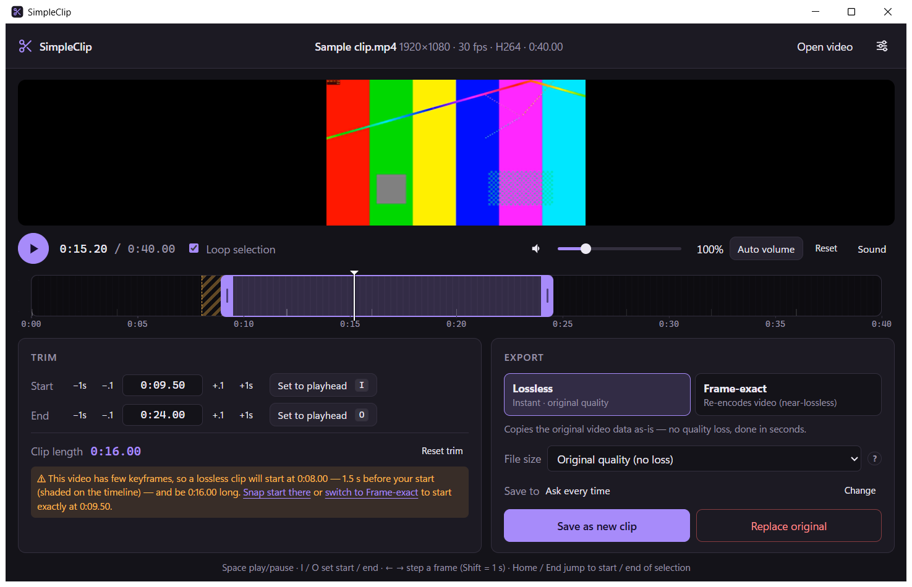

# SimpleClip

A small video trimmer for Windows. Open a video, pick the start and end, save the clip.

Website: [simpleclip.danielgarciavilches.com](https://simpleclip.danielgarciavilches.com)

## Features

- Trim MP4, MOV, MKV and WEBM files by dragging the handles, typing exact times, or pressing I / O.
- Lossless mode copies the original video data, so there is no quality loss and saving takes a second or two. The clip has to start on a keyframe; the app shows where that is before you save.
- Frame-exact mode starts on the exact frame you picked (the video is re-encoded at high quality).
- Optional smaller file sizes (High / Balanced / Small).
- Volume from 0 to 500%, and Auto volume, which brings the clip to about -14 LUFS (the level YouTube uses) without squashing loud moments.
- Optional sound tools: tame loud parts, boost quiet parts, and "Even out voices", which uses an offline AI model to separate voices from game sound and bring everyone in a voice call to a similar volume.
- Save as a new clip or replace the original.

## Download

Requires Windows 10 or 11. There are two versions, and they work the same:

- [Microsoft Store](https://apps.microsoft.com/detail/9PNR91FJXGCF): installs and updates like any other Store app.
- Portable zip: get the latest from [Releases](../../releases), unzip it and run `SimpleClip.exe`. Nothing to install, and it runs from a USB stick.

With the portable version, if Windows SmartScreen says "Windows protected your PC", click More info, then Run anyway.
Its first start can take up to a minute, because Windows checks the new files. After that it opens in a couple of seconds.

## Building from source

You need Windows 10/11 and any recent Python 3 on PATH.

1. Download `ffmpeg-release-essentials.zip` from [gyan.dev](https://www.gyan.dev/ffmpeg/builds/) and put `ffmpeg.exe` and `ffprobe.exe` in a `bin` folder next to this file.
2. Run `powershell -ExecutionPolicy Bypass -File setup.ps1` once. It sets up Python 3.12, the libraries and the voice model.
3. Run `powershell -ExecutionPolicy Bypass -File build.ps1`. The app ends up in `SimpleClip-Portable`.

To run from source without building: `.venv\Scripts\python.exe src\app.py`.

## License

The code in this repository is under the MIT License (see [LICENSE](LICENSE)).

The release zip also contains third-party parts that keep their own licenses:

- [FFmpeg](https://ffmpeg.org/) (GPLv3 build from [gyan.dev](https://www.gyan.dev/ffmpeg/builds/)), used as a separate program for cutting and audio processing.
- The Kim_Vocal_2 voice separation model from the [Ultimate Vocal Remover](https://github.com/Anjok07/ultimatevocalremovergui) project.
- [pywebview](https://github.com/r0x0r/pywebview), [ONNX Runtime](https://onnxruntime.ai) and [NumPy](https://numpy.org/).
